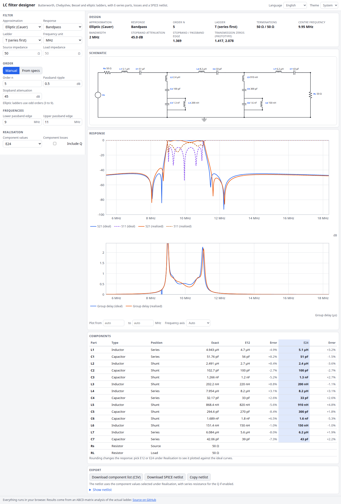

# LC Filter Designer

Design doubly terminated LC ladder filters in the browser. Pick Butterworth, Chebyshev I, Bessel or elliptic (Cauer), turn the lowpass prototype into a lowpass, highpass, bandpass or bandstop, and get the schematic, exact and E12/E24 component values, S21/S11/group-delay plots and a SPICE netlist.

**Try it: [hermes98761234.github.io/lc-filter-designer](https://hermes98761234.github.io/lc-filter-designer/)**

[](https://github.com/hermes98761234/lc-filter-designer/actions/workflows/deploy.yml)



## Features

- **Four approximations**: Butterworth, Chebyshev I, Bessel (maximally flat delay, scaled to -3 dB) and elliptic.
- **Four responses**: lowpass, highpass, bandpass, bandstop, by the usual frequency transforms of every element.
- **Order by hand or from specs**: passband ripple or attenuation, stopband attenuation at a frequency (or two edges for band filters).
- **Pi or T ladders**, equal terminations, plus unequal source/load for Butterworth. Even-order Chebyshev gets the load it needs.
- **Elliptic ladder synthesis** for odd orders 3 to 9: poles and zeros from Jacobi elliptic functions, then Cauer zero extraction.
- **Realistic response**: round parts to E12 or E24 and add inductor and capacitor Q (as series resistance); the plot shows ideal and realised curves together.
- **Export** the component list as CSV and a SPICE netlist (ngspice and LTspice compatible).
- English and Ukrainian, light, dark or system theme, settings kept in the browser. No backend, no tracking.

## How it works

Everything lives in `src/lib` as pure functions with unit tests.

- **Prototypes.** Butterworth and Chebyshev g-values use the closed forms. Bessel, elliptic and Butterworth with unequal terminations use one generic synthesiser: it builds E and F with S11 = F/E (spectral factorisation by root finding), forms Zin = (E+F)/(E-F), and expands it as a ladder. Finite transmission zeros are realised by partial removal of a series inductor followed by a shunt series-LC branch.
- **Elliptic.** The zeros come from `cd((2m-1)K/n, k)`, the stopband zeros from `1/(k z)`, and the ripple/attenuation link from the degree equation via the nome.
- **Transforms.** Each prototype inductor or capacitor is replaced by its lowpass, highpass, bandpass or bandstop network, then impedance-scaled.
- **Response.** The real ladder, with its actual parts, is analysed with ABCD matrices; group delay is the phase slope.
- **Tests** check g-values against tables (Butterworth n=3: 1, 2, 1; Chebyshev 0.5 dB n=3: 1.5963, 1.0967, 1.5963; Bessel 1.5774, 0.4226 and so on), and the analysed ladders against the textbook responses, the ripple and attenuation specs, and the band-edge behaviour.

## Quick start

You need [Node.js](https://nodejs.org/) 22.

```bash
git clone https://github.com/hermes98761234/lc-filter-designer.git
cd lc-filter-designer
npm install
npm run dev       # http://localhost:5173
npm test          # maths, export, schematic and i18n tests
npm run build     # static site in dist/
```

## Limitations

Elliptic filters are odd order only (3 to 9), and the Cauer synthesis can fail for extreme specs; the app then asks you to relax them. Unequal terminations are Butterworth only. Q is a series resistance fixed at the cutoff or centre frequency.

## License

MIT
